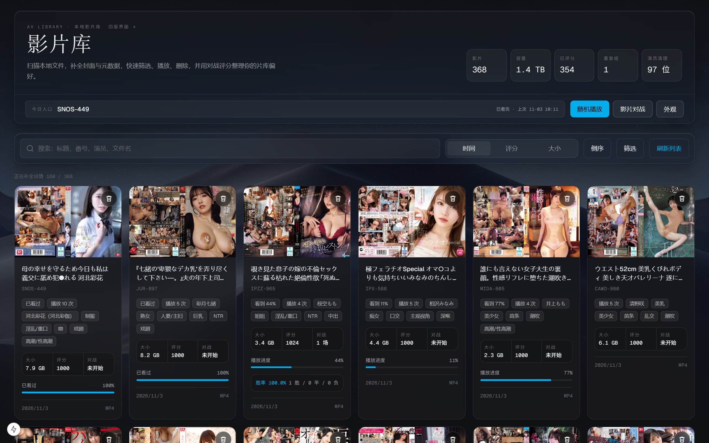

# AV Manager



一个运行在本地、管理私人影片库的 Next.js 应用：自动扫描本地视频文件，抓取封面与元数据，提供搜索筛选、流式播放、播放进度记忆、Elo 对战评分、重复影片整理，以及可自定义的玻璃风深色界面。

## 功能特性

- **影库扫描**：扫描指定目录下的视频文件，按番号自动抓取封面、标题、演员、类型等元数据（封面缓存到本地）
- **浏览与检索**：按时间 / 评分 / 文件大小排序；按标题、番号、演员、文件名搜索；演员与类型标签点选即筛；顶部指标卡一键进入重复影片 / 演员清理
- **播放**：内置流式播放器，播放器高度自动贴合视频真实比例（无黑边），独立控制条（播放/暂停、5s/10s 快进、进度、时间、音量、全屏）不遮挡画面；记忆播放进度、播完状态与观看次数
- **影片对战**：随机抽取两部影片对比打分，基于 Elo 评分（含不确定度 sigma、新片优先、近期对局去重），支持悔棋；全程键盘快捷键
- **外观自定义**：背景支持极光 / 自定义图片（本地上传原图直传服务端，不压缩、像素级清晰）或粘贴图片链接；可调浓度与每行列数；设置持久化在服务端，换浏览器、换端口、重启都不丢
- **重复整理**：识别同番号多版本文件，分组展示便于清理
- **删除**：卡片或播放器内二次确认后直接删除磁盘文件
- **代理自动探测**：抓取元数据 / 封面时自动检测本机代理（环境变量 → Windows 系统代理 → 常见端口探测），开了代理就走代理，没开就直连，无需任何配置

## 技术栈

- Next.js (App Router) + React + TypeScript
- Tailwind CSS（MARGIN 设计语言：发丝线 / Liquid Glass / 极光背景）
- node:sqlite 本地数据库（影片元数据、评分、播放历史）
- axios + cheerio 元数据抓取，Playwright 辅助

## 快速开始

### 环境要求

- Node.js 20+（需支持 `node:sqlite`）
- Windows / macOS / Linux 均可（本机代理探测的系统代理读取仅在 Windows 生效，其余平台走环境变量与端口探测）

### 部署与首次配置

1. 克隆仓库：

   ```bash
   git clone https://github.com/1998SUIYUE/av_manager_nextjs.git
   cd av_manager_nextjs
   ```

2. 安装依赖：

   ```bash
   npm install
   ```

3. 启动开发服务器：

   ```bash
   npm run dev
   ```

   生产模式可改用：

   ```bash
   npm run build && npm start
   ```

4. 打开浏览器访问 [http://localhost:3000](http://localhost:3000)，首次会要求输入影片目录路径（例如 `D:/Movies`），确认后自动进入影片库并开始扫描、抓取封面与元数据。影片数量多时首次扫描需要耐心等待。

## 使用指南

### 影片库（主页）

- 顶部指标卡：影片总数、总容量、已评分数量；**重复组** 与 **演员清理** 卡片可点击展开对应整理面板
- 「今日入口」：显示最近观看的影片与进度，点击直接续播；「随机播放」随机开一部
- 搜索框支持标题 / 番号 / 演员 / 文件名；演员、类型标签点选即筛
- 每张卡片：封面、番号、已看进度、播放次数、容量、评分、文件信息；右上角垃圾桶图标删除（两次点击确认）

### 播放

- 点击卡片打开播放器，控制条位于视频下方，不遮挡画面
- 快捷键：`←` / `→` 快退 / 快进（默认 10s，控制条上可切 5s），`空格` 暂停 / 继续
- 关闭播放器后进度自动记忆，下次从上次位置继续

### 影片对战

- 从「影片对战」进入，随机匹配两部影片（优先低场次、Elo 接近、近期未对战的对手），看完点胜负或平局
- 快捷键：`A` 左侧胜、`D` 右侧胜、`空格` 平局、`S` 跳过、`Z` 悔棋
- Elo 评分与战绩展示在卡片底部，评分数据持久化在本地

### 外观设置

- 「外观」按钮打开面板：背景模式（关 / 极光 / 图片）、浓度、每行列数（自动 / 4 列 / 6 列）
- 背景图片支持本地上传（原图直传，服务端不做任何压缩）或直接粘贴图片链接
- 所有外观设置保存在服务端 `userData/appearance.json`，跨浏览器、跨端口、重启均生效

### 重复影片 / 演员清理

- **重复组**：同番号多版本自动分组，保留一份删除其余
- **演员清理**：同一演员多番号写法变体分组，便于批量整理
- 两类删除操作均需二次确认，直接作用于磁盘文件，请谨慎操作

## 数据目录

所有数据都在 `userData/` 下，删除即完全重置：

| 文件 / 目录 | 内容 |
| --- | --- |
| `app-data.sqlite` | 影片元数据库 |
| `movie-elo-ratings.json` | Elo 评分 |
| `movie-playback-history.json` | 播放历史与进度 |
| `appearance.json` | 外观设置 |
| `bg-image.*` | 自定义背景原图 |
| `image-cache/` | 抓取的封面缓存 |
| `movie-directory.txt` | 影片目录路径 |

## 注意事项

- 本项目仅用于本地环境，未做任何鉴权，请勿暴露到公网
- 元数据抓取目标站点多数需要代理，应用会自动探测本机代理；抓取失败时请确认代理可用或网络可达
- 删除操作直接作用于磁盘文件，且不可恢复
